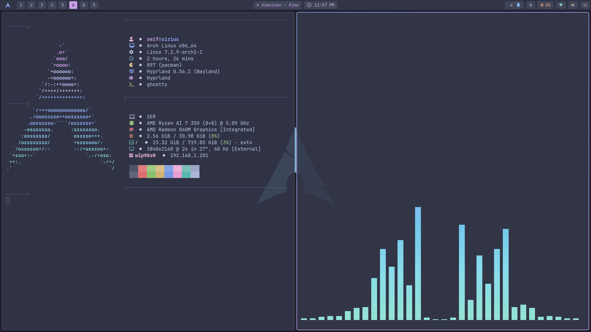
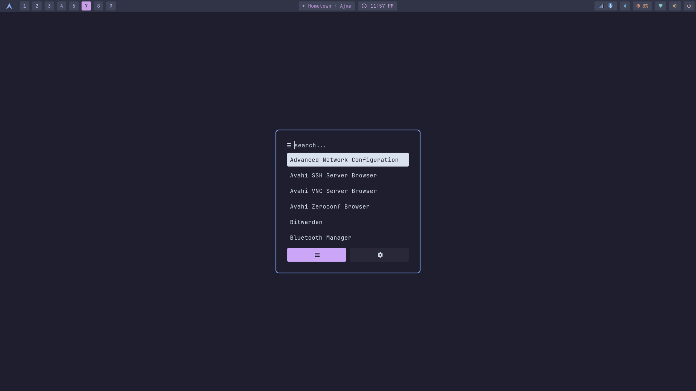
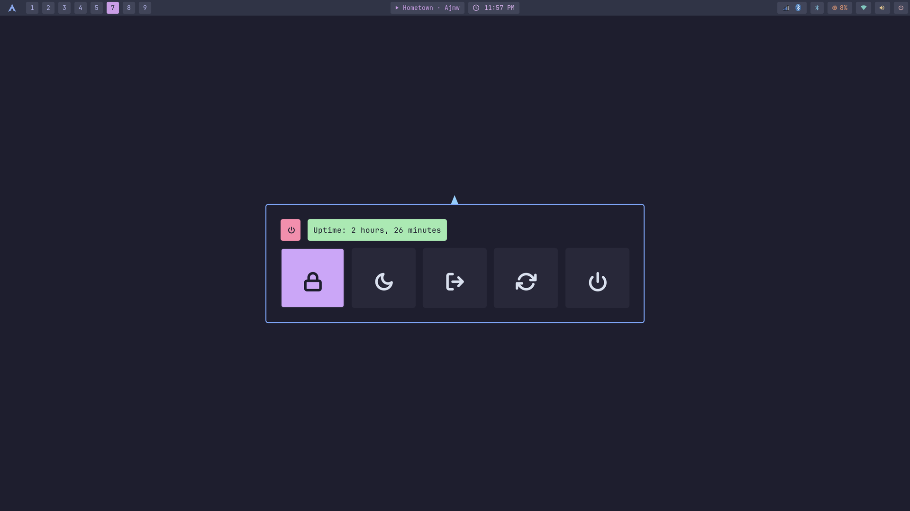
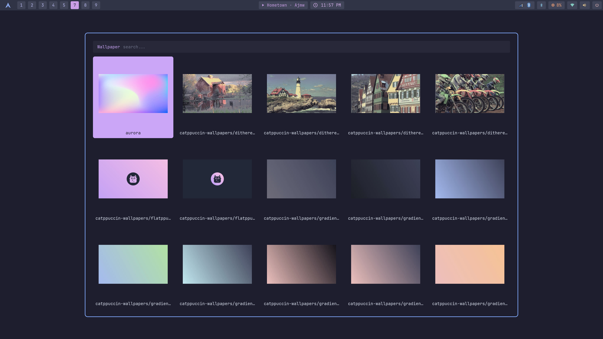
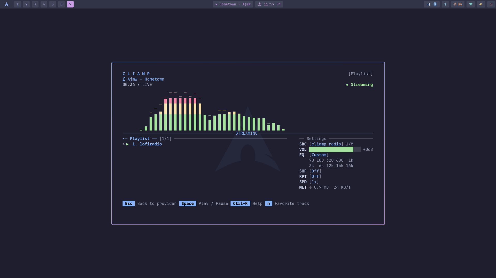
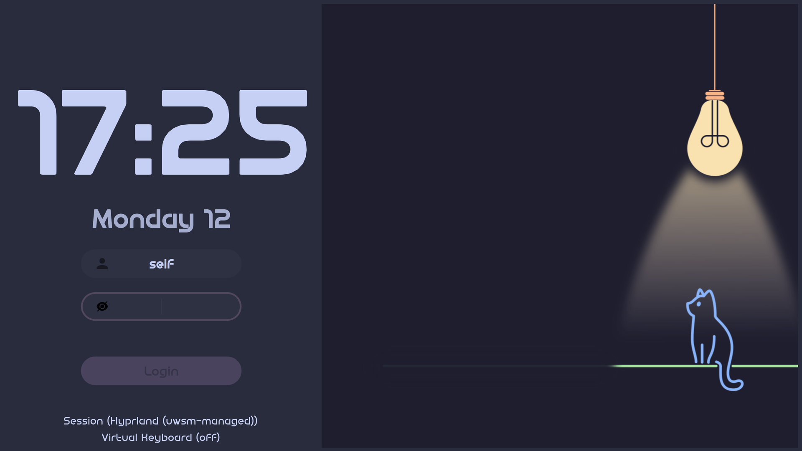
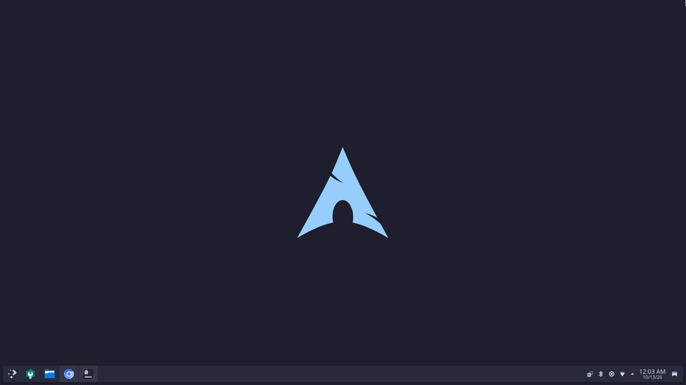

<div align="center">

# arch desktop dot files

**A Catppuccin Frappé desktop on Arch: Hyprland and KDE Plasma side by side, one wallpaper for both**


[The rice](#the-rice) · [Screenshots](#screenshots) · [Install](#install) · [Keys](#keys) · [What's here](#whats-here) · [Credits](#credits)

</div>

---



The desktop half of **sirius**, a Beelink SER9 MAX on a 4K screen. The look started as
[hyprwizrd](https://github.com/hyprwizrd/hyprwizrd-dotfiles), ported to Hyprland's newer Lua
config and stretched across Plasma too: one wallpaper picker sets both desktops, and Plasma gets
the Mac's ⌘M, ⌘H and ⌘T habits.

The terminal (zsh, Ghostty, tmux, nvim, fastfetch) lives in
[linux-dot-files](https://github.com/seifscape/linux-dot-files), shared with a Mac and a Raspberry Pi.
This repo is everything that only makes sense on a desktop.

## The rice

| | |
|---|---|
| **Window manager** | [Hyprland](https://hyprland.org) 0.56 (Lua config) · [KDE Plasma](https://kde.org/plasma-desktop/) 6.7 |
| **Bar** | [Waybar](https://github.com/Alexays/Waybar), with now playing over MPRIS |
| **Launcher · menus** | [rofi](https://github.com/davatorium/rofi) 2.0: apps, power, Bluetooth, wallpaper grid |
| **Notifications** | [dunst](https://dunst-project.org) |
| **Terminal** | [Ghostty](https://ghostty.org) |
| **Font** | JetBrains Mono Nerd Font |
| **Lock · idle** | hyprlock (a lamp lighting a cat) · hypridle |
| **Login** | [sddm-astronaut-theme](https://github.com/Keyitdev/sddm-astronaut-theme), same lamp and cat |
| **Boot** | GRUB [Vimix](https://github.com/vinceliuice/grub2-themes) · Plymouth arch-mac-style |
| **Music** | [cliamp](https://github.com/bjarneo/cliamp) (Winamp in a terminal) · [cava](https://github.com/karlstav/cava) |
| **Plasma** | Catppuccin Frappé Mauve colours · [Klassy](https://github.com/paulmcauley/klassy) decorations · Papirus-Dark icons |
| **Cursor** | Breeze recoloured to Catppuccin Frappé (`cursors/build-breeze-cursors.py`) |
| **Wallpapers** | [catppuccin_walls](https://github.com/er2de2/catppuccin_walls) · [catppuccin-wallpapers](https://github.com/zhichaoh/catppuccin-wallpapers) |

**Palette**: [Catppuccin Frappé](https://catppuccin.com/palette), accent mauve


## Screenshots

| Launcher (rofi) | Power menu |
|---|---|
|  |  |

| Wallpaper picker | Music: cliamp streaming lofi |
|---|---|
|  |  |

| Login (SDDM) | KDE Plasma |
|---|---|
|  |  |

The hero and the first four shots are Hyprland, taken by [`screenshots/take.sh`](screenshots/take.sh),
which also checks the session and plays a lofi stream so the bar and visualizer have something to show.

## Install

```sh
sudo pacman -S --needed stow hyprland hyprlock hypridle hyprpaper waybar rofi dunst \
    cava hyprshot hyprpicker pavucontrol playerctl ffmpeg librsvg
yay -S --needed cliamp sddm-astronaut-theme   # from the AUR
git clone https://github.com/seifscape/arch-desktop-dot-files ~/Developer/arch-desktop-dot-files
~/Developer/arch-desktop-dot-files/install.sh
```

`install.sh` links each folder into `$HOME` with [GNU stow](https://www.gnu.org/software/stow/),
so `~/.config/hypr` and the rest point into this repo: edit in place and the changes show up in
`git status`. Anything already in the way moves to `~/.local/state/arch-desktop-dot-files/`
first. It then downloads the images that aren't committed and, from a Plasma session, sets the
shortcuts below. Re-running it is safe.

<details>
<summary><b>The parts that need sudo</b>: wallpapers, login screen, boot splash, GRUB</summary>

| | |
|---|---|
| Wallpaper collections | `./wallpapers.sh`: clones the two Catppuccin wallpaper repos into `~/Pictures/Wallpapers`, renders the SVGs at 4K (no sudo) |
| Login screen | `sddm/install-lampcat.sh` (lamp + cat) or `sddm/install-flatppuccin.sh`, then `sddm/install-cursor.sh`. `sddm/check.sh` says what an update reset |
| Boot splash | `boot/install-plymouth.sh arch-mac-style.zip` (download it first, see [Credits](#credits)) |
| GRUB | Vimix from [vinceliuice/grub2-themes](https://github.com/vinceliuice/grub2-themes); steps in [`docs/BOOT-SETUP.md`](docs/BOOT-SETUP.md) |

</details>

## Keys

| | Hyprland | Plasma |
|---|---|---|
| Wallpaper picker | Super+W | Meta+Shift+W (Meta+W is Overview) |
| Lock | Super+L | |
| Power menu | Super+Esc | |
| Visualizer · music player | Super+A · Super+Shift+A | |
| Screenshot region · screen | Super+Print · Super+Shift+Print | |
| Colour picker | Super+Shift+P | |
| Minimize (⌘M) | | Meta+M |
| Hide app (⌘H) | | Meta+H |
| Tiling editor | | Meta+Shift+T (Meta+T is Ghostty's new tab) |

The wallpaper picker sets Hyprland and Plasma at once, from either session.

## What's here

<details>
<summary>Folders and where they go</summary>

| Folder | Goes to | What |
|---|---|---|
| `hypr/` | `~/.config/hypr` | Hyprland (Lua config): `hyprwizrd.lua` holds the look and extra keys, plus hyprlock, hypridle, hyprpaper and `scripts/wallpaper-picker.sh`. `aurora.lua` is the previous look |
| `waybar/` | `~/.config/waybar` | Top bar: workspaces, clock, now playing, tray, network, volume, power |
| `rofi/` | `~/.config/rofi` | Launcher, power menu, Bluetooth menu, wallpaper grid |
| `dunst/` | `~/.config/dunst` | Notifications |
| `cava/` | `~/.config/cava` | Audio visualizer |
| `cliamp/` | `~/.config/cliamp` | Terminal music player, Catppuccin theme |
| `kde/` | `~/.local/share` | The hide-app KWin script (Meta+H) and the wallpaper-picker launcher |
| `fonts/` | `~/.local/share/fonts` | Feather icon font for the power menu |
| `sddm/` | `/usr/share/sddm`, `/etc/sddm.conf.d` | Login screen styles, cursor config, install and check scripts |
| `boot/` | `/usr/share/plymouth` | Boot splash installer |
| `cursors/` | `~/.local/share/icons` | Builds the Catppuccin-coloured Breeze cursors |
| `docs/` | | The full notes: [`DESKTOP-THEME.md`](docs/DESKTOP-THEME.md) and [`BOOT-SETUP.md`](docs/BOOT-SETUP.md) |

</details>

## Credits

- Look ported from [hyprwizrd/hyprwizrd-dotfiles](https://github.com/hyprwizrd/hyprwizrd-dotfiles).
  Its repo has no licence, so its images (the lamp, the cat wallpapers) aren't committed here;
  `fetch-assets.sh` downloads them from it.
- rofi launcher and power menu by [adi1090x](https://github.com/adi1090x/rofi), Bluetooth menu
  by [nickclyde](https://github.com/nickclyde/rofi-bluetooth). Author headers kept in the files.
- Login screen theme: [Keyitdev/sddm-astronaut-theme](https://github.com/Keyitdev/sddm-astronaut-theme).
- Boot splash: arch-mac-style by tobilinuxer, from
  [opendesktop.org/p/2106821](https://www.opendesktop.org/p/2106821). Not redistributed here.
- Wallpapers: [er2de2/catppuccin_walls](https://github.com/er2de2/catppuccin_walls) and
  [zhichaoh/catppuccin-wallpapers](https://github.com/zhichaoh/catppuccin-wallpapers).
- Colours: [Catppuccin](https://catppuccin.com).

---

<div align="center">

Companion to [**linux-dot-files**](https://github.com/seifscape/linux-dot-files) and [**macos-dot-files**](https://github.com/seifscape/macos-dot-files) · Catppuccin everywhere

</div>
